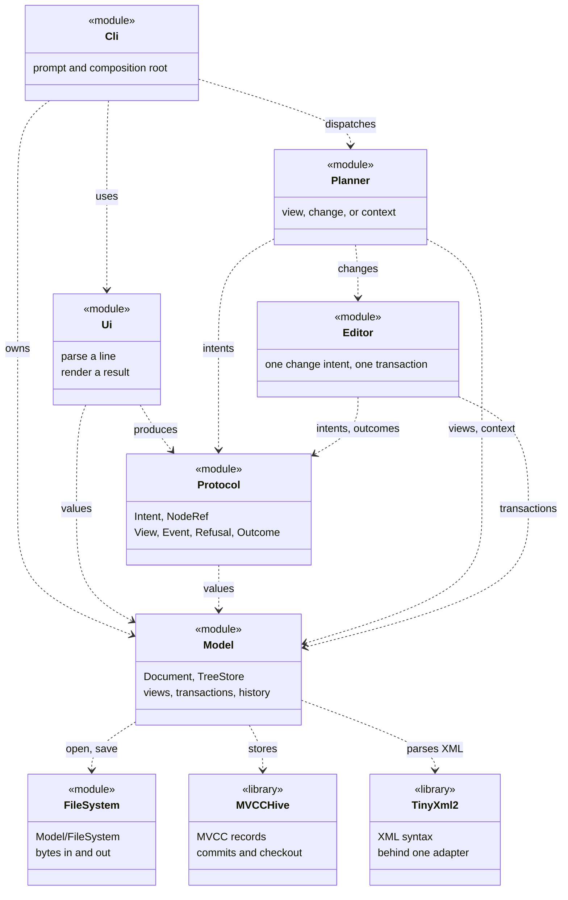

# SVG Editor Design Overview

This is the map of the design: the modules and their roles, the patterns that carry the
implementation, every dependency direction, and the changes the structure expects. The
pipeline vocabulary and command syntax are in [Pipeline.md](Pipeline.md); the tree,
history and cost model are in [Model.md](Model.md).

## Modules

| module              | what it is                                                        | depends on                    |
| ------------------- | ----------------------------------------------------------------- | ----------------------------- |
| `Model/`            | the SVG tree: where it is stored, how it is read, how it is edited  | MVCCHive, tinyxml2            |
| `Model/FileSystem/` | bytes in and out of the document's file                             | -                             |
| `Protocol/`         | the vocabulary the pipeline passes around, in the six parts it is made of: how a node is named, the intents, the views, the events, the refusals, the outcome | Model (for the values) |
| `Editor/`           | translates one change intent into tree transactions                 | Model, Protocol               |
| `Planner/`          | decides what one instruction means                                  | Model, Editor, Protocol       |
| `Ui/`               | the text front end: parses one line into an intent, prints the outcome; owns the document | Planner, Model, Protocol |

Three rules hold the shape together:

- **MVCCHive and tinyxml2 are Model's dependencies.** The hive is the arena the tree is stored
  in: only `Model/` fetches it (`Model/cmake/MVCCHive.cmake`) and only `Model/`
  uses it - its transactions, commit ids and virtual ids are Model's business,
  and no other module opens one. tinyxml2 is fetched by `Model/cmake/TinyXml2.cmake`;
  its pointer-based DOM is confined to `Model/src/TinyXml2Adapter.cc`, which converts
  it to the pointer-free `XmlSnapshot` vectors the SVG reader uses.
- **Everything above Model reaches the document through Model.** The Editor
  writes to it, the Planner reads it, and the Planner never talks to the Editor
  about anything but a change intent.
- **Text is the ui layer's business, in both directions of the boundary.** What a
  user typed becomes a typed intent before it leaves `Ui/`, so no layer above ever
  parses a string, and no layer below knows how an instruction was written.

Because `Document` holds the arena by value, the hive's headers do reach the other
modules' include path, so the link line no longer says who may use it. The test
named `layering` reads the sources and fails if a module outside Model names MVCCHive,
`mvcc_hive` or tinyxml2, or if a Model source other than the adapter mentions tinyxml2.

The text front end is also the composition root: it owns the `Document` and hands
it to the Editor and the Planner. A gui front end would sit in exactly the same
place, which is why the document is owned above the Planner rather than inside it.

The module graph is a dependency graph, not a call trace; an arrow means "may
include or link", and the directions below are the ones the CMake targets declare.



## The bone: `variant + visit + handle<T>`

The central structural decision is not a class hierarchy. It is a closed
`std::variant`, visited by `std::visit`, with one `handle<T>` for each alternative:

```C++
// Every instruction is one alternative of Intent.
Outcome dispatch(const Intent& intent) {
    return std::visit([](const auto& value) { return handle(value); }, intent);
}

template<typename T>
Outcome handle(const T& intent);

template<>
Outcome handle<Create>(const Create& intent);
```

Three properties make this the bone of the project:

1. **The variant is the authoritative case list.** Adding a command, element kind,
   attribute or model payload changes the type. There is no second registry to update.
2. **The visit is exhaustive.** `std::visit` asks `handle<T>` for every alternative. The
   primary template's discarded branch uses `static_assert(false, ...)`, so an alternative
   with no route is a build error, not a `default:` branch that silently does nothing.
3. **The handler is the operation.** Explicit specializations live next to the file that
   owns the behaviour, and overload sets answer the nested questions: which shape, which
   container, which colour, which transform.

### Exhaustive dispatch is a structural rule

Every dispatcher over one of the project's variants must fail through an intentional,
dependent `static_assert` when an alternative has no answer. A missing overload that
leaves `std::visit` to report "no matching call" does not meet that rule.

There are two accepted forms:

- a function template whose primary definition contains
  `static_assert(always_false<T>, ...)`, followed by explicit specializations; or
- a visitor object with one overload per alternative and a generic `operator()` whose
  body contains the same assertion for an unknown alternative.

`always_false` lives in `Model/include/Exhaustive.hh`. `ElementName.hh` is the model for a
function-template mapping. The rendering, serialization, file-status and request visitors
use the generic-operator form. `Set` has a primary `apply<Attribute>` template as well, so
a new attribute cannot escape through an overload failure.

An overload set may not be called from a generic `std::visit` without a primary template
that carries the assertion. This was a real defect in element naming and in `Set`:
adding an alternative produced a vague overload-resolution error instead of the project's
exhaustiveness error.

The rule also forbids runtime fallthroughs:

- do not inspect some alternatives with `holds_alternative` and then treat everything
  remaining with `std::get`; dispatch the whole variant;
- do not use `if (holds_alternative<A>) ... else std::get<B>` on a closed variant;
- a capability-based `if constexpr` must explicitly name the non-capability alternative;
  it may not silently ignore an unknown alternative.

In particular, shape translation uses a visitor rather than assuming the last remaining
alternative is a line; `SvgWriter::write_node` dispatches both `Node` payloads; and
`TreeStore::visit_data` permits only `PlainText` as a non-element payload. These replace
runtime exceptions or silent omission with compile-time failures.

The same skeleton carries the whole pipeline:

| question | variant | dispatch point |
| --- | --- | --- |
| What did the user ask for? | `Intent` | `Planner::dispatch()` calls `visit` and then `handle<T>` |
| Is this instruction a change? | `ChangeIntent` | The Planner's `if constexpr (std::is_constructible_v<ChangeIntent, T>)` route sends it to `Editor::translate()` |
| Which element is being created? | `Create` | `handle<Create>` visits the element alternatives; each one reaches `new_element()` by overload |
| Which attribute is being set? | `Set` | `handle<Set>` visits the attribute alternatives |
| What kind of node is this? | `Node` | `std::visit` asks the payload; `if constexpr` asks whether it has child links |
| How is this element named or printed? | `Shape`, `Container`, `Color`, `Transform` | A template mapping or a visitor with an asserted fallback answers one kind at a time |

This one structure replaces several inheritance-shaped patterns at once. A virtual
`Command::execute()` becomes a variant alternative; a Visitor with `accept()` becomes
`visit` plus `handle<T>`; a Template Method base class becomes the fixed visit with a
specialized handler; a factory subclass becomes an overload; a Strategy object becomes a
table row. The patterns' intent survives, but the dispatch is composition and type-level
selection rather than an object graph.

The price is deliberate: the alternatives are closed at compile time. A new command or
node kind is a source change and a rebuild, not a runtime plugin. In exchange, the cases
cannot drift apart, and the compiler tells the developer exactly which handler is
missing.

## Design patterns: the GoF catalogue

**Command is used.** `Intent` is a command object: it packages a request as data before
anything performs it. `Planner::dispatch()` is the invoker, `Editor::translate()` is the
command executor on the write path, and `Document`/`TreeStore` are the receiver that
actually changes the tree. One command is one transaction and one history block. `Undo`
and `Redo` are commands too; the historical state itself is MVCCHive's checkout, not a
per-command inverse object.

The command is a variant alternative rather than a `Command` base class with a virtual
`execute()`. That is the same trade the rest of the project makes: the type decides the
handler, and a missing handler is a compile error instead of a virtual call that does
nothing.

With the skeleton established, the GoF catalogue can be read by intent rather than by
class syntax. The useful distinction is between a live role, a grey-zone equivalent that
keeps the spirit but not the book's structure, and a pattern this project replaces or
defers.

This section names the patterns with a live role, the ones whose intent survives in a
restricted form, and the few a reviewer would reasonably expect for this kind of editor
that are handled another way.

### Patterns with a live role

| pattern | form | where it lands |
| --- | --- | --- |
| Command | Variant command | `Intent` is the command, `Planner::dispatch()` invokes it, `Editor::translate()` executes it, and `Document` receives the transaction. One command is one commit; undo and redo are commands over the history |
| Composite | Tree | `Node` is a variant of `SVGNode` and `PlainText`, and `ChildAttr` holds the ends of a child list. Tree views, subtree erasure and grouping recurse through the same structure |
| Facade | Document boundary | `Document` exposes `root()`, `node()`, `children()`, `parent()`, `find()` and `transaction()` while `TreeStore` and MVCCHive stay behind it |
| Visitor | Static visitor | `std::visit` over `Intent`, `Create`, `Set`, `Node`, `Event` and `Refusal`, with `template<> handle<T>()` and overload sets. A missing case is a build error |

### Grey zone: the spirit without the class hierarchy

| pattern | what the project actually has | where it diverges from the book |
| --- | --- | --- |
| Template Method | `std::variant` is a closed, restricted template; `std::visit` fixes the skeleton and `handle<T>()` supplies the varying step | There is no base class, no virtual hook and no subclass override. It is a compile-time Template Method in spirit, not the GoF structure. It trades the open subclass set for a closed variant set and gains compile-time exhaustiveness |
| Factory Method | A named-constructor/overload-based factory: `Editor::new_element()` overloads build the element named by the static type | There is no subclass factory and no polymorphic creator. The separation of construction from `create()` is kept; the inheritance is not |
| Strategy | A verb table: `verbs()` selects a reader, and `Create`/`Set` use the same table shape | The algorithm is selected by a key, but there is no policy object held by a context. The table is the registry |
| Adapter | A boundary visitor: `OpenStatus` and `SaveStatus` adapt `model_status` to `Outcome`, and `Rendering` adapts protocol values to text | The adaptation is a function object at a module boundary, not a wrapper class around an existing interface |

The grey zone is the normal shape of this codebase: inheritance is replaced by
composition, and the pattern's intent is preserved by a variant plus exhaustive
visitation. That is why calling these patterns "used" or "not used" without qualification
would both be misleading.

### Replaced or deferred

Each entry names the need that usually attracts
the pattern and the reason why this design handles it differently.

| pattern | status | reason |
| --- | --- | --- |
| Memento | Replaced by MVCC checkout | A classic Memento saves a full state or an inverse per edit. For a tree with many small edits, whole-state snapshots duplicate payloads and per-command inverses duplicate undo logic. MVCCHive instead stores immutable versions and 32-byte, 32-byte-aligned diff records in fixed-size blocked arrays; an edit writes only the changed records, history stays dense, and undo/redo moves the checkout. The choice was driven by the cost model: whole-state snapshots duplicate payloads and per-command inverses duplicate undo logic. MVCCHive's 32-byte aligned diff records in blocked arrays keep history dense and let undo/redo move the checkout. |
| Observer | Deferred | There is one Ui window. A command already returns `Event` for a change and `TouchedNodes` for undo/redo, so separating sender from observer now would add subscription lifetime without a second consumer. Multiple windows over one backend would make an observer or notification layer the natural refactor |
| State | Deferred | The CLI has no modal tool state, so a State hierarchy would invent transitions. The pattern becomes relevant when GUI tools such as select, draw and move exist |
| Singleton | Refused | The composition root owns `Document` explicitly. A global instance would hide that lifetime, make tests share state, and block future multi-document sessions |
| Interpreter | Refused | The command language is flat: one line becomes one typed intent through a table row. An AST interpreter would be a second representation to keep in step with `Intent` |
| Iterator | Refused for now | `children()` returns a snapshot vector so a view can outlive an MVCC snapshot, and tree walks are short recursive loops. A custom iterator would pin or expose storage for no current gain |
| Mediator | Refused | The Ui has one call into the Planner, and the Planner has explicit typed routes to Model and the Editor. There is no peer-to-peer colleague graph to centralize; a mediator would add a registry and a second routing layer |

Architectural patterns outside the GoF catalogue still matter: the layered module
boundaries are in "Modules" above, the Unit of Work/RAII transaction is described in
[Model.md](Model.md), and MVCCHive's MVCC checkout is described there as the history
mechanism.

## Dependency direction

The arrows point from policy toward the stable tree model. `Model` is the bottom of the
application graph because it owns the document and its history; `Model/FileSystem` and
MVCCHive are mechanisms underneath it. `Protocol` is the one dependency that points
"back" into Model: the vocabulary is made of model values on purpose, because a second,
duplicated set of length, colour and node types would only create conversion code.

**Removable** below means the edge can be deleted without changing the module's
behaviour, at the cost named in the reason. "Replaceable" means the implementation can
change behind the same target, but the edge stays.

| from | to | how | why | status |
| --- | --- | --- | --- | --- |
| `Model` | MVCCHive | `FetchContent`, public link, `TreeStore.hh` | The tree is stored as MVCC records, and the hive supplies commits, snapshots and checkout | Required; the storage engine is replaceable behind `TreeStore`, but the dependency is not removable |
| `Model` | tinyxml2 | `FetchContent`, private link, adapter source only | XML syntax is not worth maintaining beside the SVG schema, while the adapter keeps its pointers and DOM out of the rest of Model | Required for file input; replaceable behind the adapter |
| `Model` | reflection-cpp | `FetchContent`, private link, `SvgSchema.cc` only | Aggregate reflection derives element and attribute names from the schema's member names while retaining exact hand-written family and attribute-set rules | Required for the current schema representation; replaceable by another compile-time reflection implementation |
| `Model` | `Model/FileSystem` | private link; `Document.cc` includes `FileSystem.hh` | `open()` and `save()` need bytes from and to a file | Required for the file commands; removable only if the product drops file I/O |
| `Protocol` | `Model` | interface link; includes `SVGNode.hh`, `Document.hh`, `History.hh` | `Intent`, `View`, `Event` and `Refusal` carry model values and handles; views project payloads without the hive's parent, sibling, or child-list links | **Removable** by moving the value types into a separate `Values` or `Core` target, or by making `Protocol` own DTOs; both add a conversion layer for no current benefit |
| `Editor` | `Model` | public link; `Document.hh` | The Editor is the only writer and needs the transaction API | Required |
| `Editor` | `Protocol` | public link; `Intent.hh`, `Outcome.hh` | A change intent is the Editor's input and an outcome is its output | Required |
| `Planner` | `Model` | public link; `Document.hh` | Views read the tree, and `init`/`read`/`save` change the document context | Required |
| `Planner` | `Editor` | public link; `Editor.hh` | A change intent has to reach the write path | Required |
| `Planner` | `Protocol` | public link; `Intent.hh`, `Outcome.hh` | The Planner's input and output are the protocol | Required |
| `Ui` | `Protocol` | public link; `Intent.hh`, `Outcome.hh` | Parsing produces intents and rendering consumes outcomes | Required |
| `Ui` | `Model` | public link; `SVGNode.hh`, `NodeRef.hh` | The front end parses lengths, colours and node ids into model values | **Removable** if those values move behind `Protocol` or a separate value target; that is a type-layout move, not a behavioural one |
| `Cli` | `Ui` | private link; `main.cc` includes `IntentParser.hh`, `Rendering.hh` | The executable is the prompt and the renderer around the Ui library | Required while the CLI is the only front end |
| `Cli` | `Planner` | private link; `Planner.hh` | The CLI hands each parsed intent to the Planner | Required |
| `Cli` | `Model` | private link; `Document.hh` | The composition root owns the `Document` and constructs the Editor and Planner | **Removable** by moving composition into a `Session`/`Application` object in `Ui` or a dedicated composition target; the dependency then belongs to that object instead |
| `tests` | `Ui`, `Planner`, `Model`, `Editor` | test target links | Tests drive the same pipeline a front end does | Test-only, not a product dependency |
| every module | `SvgEditor::Warnings` | interface target | Warnings belong to our code, not to fetched dependencies | Build-only; removable with the warning target |
| `Model` public headers | MVCCHive headers | public include path through `TreeStore.hh` | `Document` holds `TreeStore` by value, and `TreeStore` holds the hive by value | **Not removable** without hiding the storage behind a pointer or PIMPL, which the no-pointer and cache-locality decisions reject; the `layering` test guards use, not inclusion |

The target graph is therefore one DAG:

```text
Cli -> Ui -> Protocol -> Model -> MVCCHive
Cli -> Planner -> Editor -> Model
Cli -> Model
Planner -> Model
Ui -> Model
Model -> Model/FileSystem
```

Only the `Model -> MVCCHive` and `Editor/Planner -> Model` edges carry behaviour.
Everything else is either a vocabulary edge, a composition-root edge, or a test edge. A
new dependency should have to say which of those it is before it is added.

## What happens after one instruction

> Here [M a b...] means this process mainly requires module b in a;

1. A line is read and parsed into a typed intent: a `Create` (holding a `CreateRect`, a
   `CreateCircle`, ...), a `Delete`, a `Read` - one of the alternatives of `Intent`. The
   values in it are model values by then - a `LengthPercentage`, a `Color`, a `NodeRef` - so
   nothing above this point sees a string a user typed. [M Ui] [M Protocol]
2. The Planner decides what that intent means, and that is the whole decision:
   [M Planner]
   - a **view** is served by reading the tree directly [M Model]
   - a **change** goes to the Editor, which translates it into a tree-level
     transaction [M Editor] [M Model]
   - a **context change** goes to the file layer, because it changes which
     document is being edited rather than the tree in it [M Model/FileSystem]
3. The outcome travels back the way it came: which branch produced it, and one of three
   structured answers - a `View` for a read, an `Event` saying what changed, or a
   `Refusal` saying why nothing changed. None of them carries user-facing prose; the ui
   layer turns the structure into words. [M Protocol] [M Ui]

A document starts absent: `Document::root()` is `no_id` until `init` makes one or
`read` loads one. The Planner answers those two without a document; every other
instruction, views included, is refused with
`error: no document. use 'init' or 'read' first`.

## Change assumptions

The likely changes fall into three groups: extensions the type system already forces a
developer to finish, implementation seams that exist but have nothing behind them yet,
and axes that are deliberately left closed until a second implementation makes the
abstraction worthwhile. The third group is as much a design decision as the first two.

| likely change | is there a place for it? | where it lands, and what it costs |
| --- | --- | --- |
| A GUI or web front end replaces the terminal | Mostly | `Intent` in, `Outcome` out, and `Ui/src/Rendering.cc` owns the wording. The prompt loop and the composition root in `Ui/src/main.cc` are terminal-shaped, so a front end would need a session/application object and an event loop around the same Planner |
| The supported SVG subset grows | Yes | Add the payload alternative first, then one strict reader mapping, one writer case and one entry in the renderer's exhaustive visitors. The parser stages values before touching `TreeStore`, so a new schema rule cannot expose a half-loaded document. A feature needing namespace resolution beyond the pointer-free snapshot would extend the adapter |
| A new command is added | Yes, at compile time | Add an intent struct to `Intent`/`ChangeIntent`, a row and reader in `Ui/src/Command.cc`, and a Planner or Editor route. A missing route is `static_assert(false, ...)` naming the type, not a runtime fallback |
| A new element kind is added | Yes, at compile time | Extend `Create` and the `Node` payload variants; the element-name visitors, builders and renderer fail to compile until each new kind is named. Runtime plugin kinds are not supported |
| A new attribute is added | Yes, at compile time | One `SetX`-style struct with its `name`, one row in `Ui/src/Set.cc`, and an Editor write. The closed `Set` variant means an unhandled attribute cannot disappear into a stringly typed default |
| The storage engine changes | Partly | `TreeStore` is the only place that opens MVCCHive, so the edit/read code is insulated. `Document.hh` and `TreeStore.hh` still expose hive types, and the CMake link is public because the hive is held by value; a swap touches Model's headers and build file |
| Two documents or tabbed editing | Partly | A `Document` is one tree plus one history and is deliberately non-movable, so a document manager cannot simply put them in a growing `std::vector`. Stable storage, one session per front end, or a redesigned `Document` would be needed |
| Undo groups several gestures into one step | Not reserved | One intent is one transaction and one commit. The transaction API can hold several edits, but the Planner/Editor mapping does not coalesce commands; a GUI gesture model would need a policy layer above the Editor |
| Concurrent readers or collaborative writers | Not reserved | The hive is MVCC, but `Document` exposes one checkout and one writer, and no API promises thread safety. Collaboration needs explicit synchronization, conflict policy and change attribution above the storage layer |
| Incremental or asynchronous loading | Not reserved | Commands are synchronous and `read` returns only when the parse is done. Chunked commits help the bulk-insert cost, but cancellation and progress reporting would need new protocol and Model APIs |
| SVG-id lookup becomes a hot path | Yes | `Document::find()` is the seam; it currently walks the tree. An index can be added behind it without changing callers, with invalidation tied to the same transactions that change ids |
| History retention needs a policy | Partly | `clear_history()` exists and MVCCHive can prune history, but there is no user-visible retention setting. Adding one belongs in Model, because commit ids and pruning are storage details |
| A new length system or unit family appears | Partly | `Length::Unit` and Model's unit table are the place to extend. Metric and imperial are intentionally separate, so a new family needs a conversion rule and a rendering name; user units, `em` and `ex` stay outside both systems |
| A new transform operation appears | Yes | The model stores one affine matrix. A new named input form is a parsing case that composes a matrix, and the TRS+skew writer needs no case for it; a form that the decomposition cannot represent is the only design question |
| The interface is localized or themed | Partly | All user-facing prose is already isolated in `Ui/src/Rendering.cc` and `usage()`, and outcomes are structured rather than pre-worded. There is no message catalog or locale parameter yet |
| A format other than SVG is imported or exported | Not reserved | `Model/FileSystem` is byte I/O, and `Document::open/save` assume the SVG tree. A general codec interface would be a new Model boundary, not a change inside the existing one |
| The pipeline is split across a process or network | Not reserved | `Intent`, `View`, `Event` and `Refusal` are in-process C++ values with no serialization or versioning. The clean boundary makes it possible, but no wire format is reserved |

The deliberate omissions are the plugin node protocol, runtime attribute bags, a generic
document model, an observer/event bus, and a generic file-codec layer. Each would add an
extension point before there is a second implementation to justify it, and each would
weaken one of the guarantees this code relies on: exhaustive visitors, typed attributes,
one storage model, or one explicit result per command.
