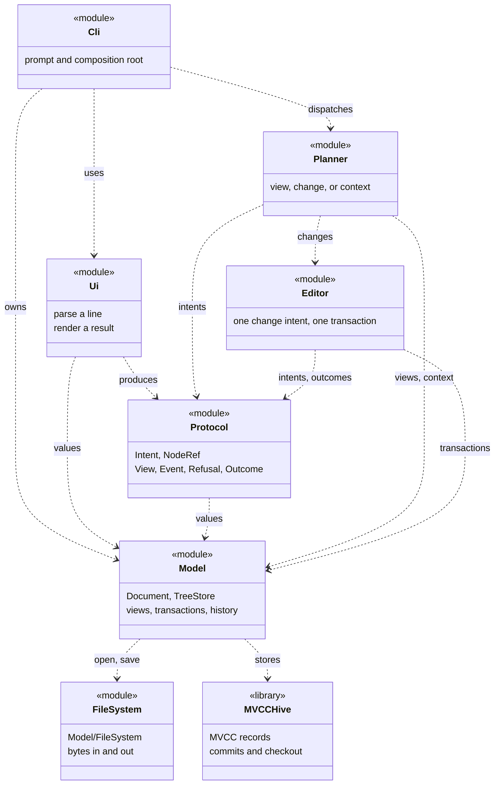

# SVG Editor Design Overview

This is the map of the design: the modules and their roles, the patterns that carry the
implementation, every dependency direction, and the changes the structure expects. The
pipeline vocabulary and command syntax are in [Pipeline.md](Pipeline.md); the tree,
history and cost model are in [Model.md](Model.md).

## Modules

| module              | what it is                                                        | depends on                    |
| ------------------- | ----------------------------------------------------------------- | ----------------------------- |
| `Model/`            | the SVG tree: where it is stored, how it is read, how it is edited  | MVCCHive                      |
| `Model/FileSystem/` | bytes in and out of the document's file                             | -                             |
| `Protocol/`         | the vocabulary the pipeline passes around, in the six parts it is made of: how a node is named, the intents, the views, the events, the refusals, the outcome | Model (for the values) |
| `Editor/`           | translates one change intent into tree transactions                 | Model, Protocol               |
| `Planner/`          | decides what one instruction means                                  | Model, Editor, Protocol       |
| `Ui/`               | the text front end: parses one line into an intent, prints the outcome; owns the document | Planner, Model, Protocol |

Three rules hold the shape together:

- **MVCCHive is Model's dependency.** The hive is the arena the tree is stored
  in: only `Model/` fetches it (`Model/cmake/MVCCHive.cmake`) and only `Model/`
  uses it - its transactions, commit ids and virtual ids are Model's business,
  and no other module opens one.
- **Everything above Model reaches the document through Model.** The Editor
  writes to it, the Planner reads it, and the Planner never talks to the Editor
  about anything but a change intent.
- **Text is the ui layer's business, in both directions of the boundary.** What a
  user typed becomes a typed intent before it leaves `Ui/`, so no layer above ever
  parses a string, and no layer below knows how an instruction was written.

Because `Document` holds the arena by value, the hive's headers do reach the other
modules' include path, so the link line no longer says who may use it. The test
named `layering` reads the sources of every module but Model and fails if one of
them names MVCCHive or `mvcc_hive`.

The text front end is also the composition root: it owns the `Document` and hands
it to the Editor and the Planner. A gui front end would sit in exactly the same
place, which is why the document is owned above the Planner rather than inside it.

The module graph is a dependency graph, not a call trace; an arrow means "may
include or link", and the directions below are the ones the CMake targets declare.



## Design patterns

A pattern earns its place here only when it removes a decision from a layer that
should not make it. Most of the classic patterns below therefore land as values and
type-level dispatch rather than as a hierarchy of classes: the instruction is data,
the type chooses the handler, and the compiler is the registry.

| pattern | where it actually lands | what it buys | what it deliberately does not do |
| --- | --- | --- | --- |
| Layered architecture | `Ui` parses and renders; `Planner` routes; `Editor` translates a change; `Model` stores and reads; `Model/FileSystem` moves bytes | Each layer has one reason to change, and a front end can be replaced without teaching the document about widgets | It is not a call-through stack: the Planner reads Model directly for a view, and the context commands go to Model rather than through the Editor |
| Command | `Intent` is a variant of instruction structs; `Planner::dispatch()` routes one; `Editor::translate()` executes one | A command is data before it is an action, so a CLI and a future GUI can produce the same command, and one command is one history block | There is no `Command` base class with a virtual `execute()`: the variant and the visitor replace the hierarchy |
| Interpreter, table driven | `Ui::parse()` splits words, `verbs()` is a table of readers, and `Ui/src/Create.cc` and `Ui/src/Set.cc` have the same shape for their second-level vocabulary | Adding a verb is a row and a reader; the help text and the accepted vocabulary cannot drift apart unnoticed | It does not build an expression tree: the language has one instruction per line, so a reader is the whole grammar |
| Static Visitor | `std::visit` over `Intent`, `Create`, `Set`, `Node`, `Transform`, `Event` and `Refusal`, with `template<> handle<T>()` as the overload set | Double dispatch without virtual calls, and a missing case is a build error rather than a branch that quietly does nothing | It is not the Gang of Four `Visitor` class with `accept()`; specializations and overload sets are the visitor |
| Composite | `Node` is a variant of `SVGNode` and `PlainText`; `ChildAttr` holds the ends of a child list; tree views, subtree erasure and grouping all recurse through it | "This node and everything under it" has one representation, whether the operation is a read, a delete or a move | It does not expose a separate container hierarchy to callers: the payload's type says whether it can hold children |
| Facade | `Document` exposes `root()`, `node()`, `children()`, `parent()`, `find()` and `transaction()`; `TreeStore` and MVCCHive stay behind it | The rest of the project can read and edit the tree without knowing how records are stored or how history is represented | The facade does not try to hide the storage type completely: `Document` holds `TreeStore` by value, so the hive's headers still reach public includes |
| Unit of Work, with RAII | `Document::transaction()` returns a `Transaction`; every change intent opens one, performs all of its tree edits, and commits once | An instruction either lands whole or not at all; a failed translation destroys the transaction and rolls back | It is not a general-purpose session transaction: only one writer is open at a time, and the Editor is the only module that opens one |
| MVCC and checkout | MVCCHive stores immutable record versions and commits; `TreeStore` keeps only the current checkout snapshot; undo and redo move that checkout | Undo is a pointer move in the version store, not a replay of inverse commands; old snapshots keep removed records alive until the history releases them | It is not Memento: there is no copy of the whole document per edit, and the caller does not own a restore object |
| Adapter | `OpenStatus` and `SaveStatus` in `Planner/src/Planner.cc` turn `model_status` values into `Outcome`; `Ui/src/Rendering.cc` turns protocol values into text | The file layer, the pipeline and the front end can each keep their own vocabulary without translating through strings | The adapter is a function object, not a wrapper class; it is only worth a type where a real boundary exists |
| Application-service pipeline, MVC-like | `Document` is the model, the Planner (with the Editor on the write path) is the controller, and `Ui` is the view and composition root | The view asks for an intent to be handled rather than reaching into the tree, which is what makes a graphical front end possible | It is not strict Smalltalk MVC: there is no observer, the Ui owns the document, and `Outcome` carries the presentation data back explicitly |
| Static factory | `Editor::new_element()` overloads build a `NewElement`; `element()` and `characters()` share the common construction | The kinds are the alternatives of `Create`, so a new kind with no builder is a build error and no factory registry has to be maintained | It does not select a builder by a runtime string below the Ui; the element kind has already become a type by then |
| Table-driven strategy | A `Verb` row holds the name and the reader; `Set` and `Create` use the same table shape for their alternatives | The policy for one word is a function selected at startup, not a chain of `if` tests that grows with the vocabulary | The table is a fixed compile-time array, not a plugin registry; the vocabulary is closed on purpose |

Two patterns are intentionally absent. There is no observer or event bus: a successful
command returns an `Event`, and undo/redo return a `TouchedNodes` list, so a front end
refreshes after the command it issued rather than subscribing to the model. There is also
no plugin protocol for node kinds: `Intent`, `Create`, `Set` and `Node` are closed
variants, which is what makes every missing case a compile error. Runtime plugins would
buy extensibility by giving up that guarantee.

## Dependency direction

The arrows point from policy toward the stable tree model. `Model` is the bottom of the
application graph because it owns the document and its history; `Model/FileSystem` and
MVCCHive are mechanisms underneath it. `Protocol` is the one dependency that points
"back" into Model: the vocabulary is made of model values on purpose, because a second,
duplicated set of length, colour and node types would only create conversion code.

**Removable** below means the edge can be deleted without changing the module's
behaviour, at the cost named in the reason. "Replaceable" means the implementation can
change behind the same target, but the edge stays.

| from | to | how | why | status |
| --- | --- | --- | --- | --- |
| `Model` | MVCCHive | `FetchContent`, public link, `TreeStore.hh` | The tree is stored as MVCC records, and the hive supplies commits, snapshots and checkout | Required; the storage engine is replaceable behind `TreeStore`, but the dependency is not removable |
| `Model` | `Model/FileSystem` | private link; `Document.cc` includes `FileSystem.hh` | `open()` and `save()` need bytes from and to a file | Required for the file commands; removable only if the product drops file I/O |
| `Model/FileSystem` | C++ standard library | `fstream`, `sstream` | Reading and writing a file is the whole module | No project dependency to remove |
| `Protocol` | `Model` | interface link; includes `SVGNode.hh`, `Document.hh`, `History.hh` | `Intent`, `View`, `Event` and `Refusal` carry model values and handles | **Removable** by moving the value types into a separate `Values` or `Core` target, or by making `Protocol` own DTOs; both add a conversion layer for no current benefit |
| `Editor` | `Model` | public link; `Document.hh` | The Editor is the only writer and needs the transaction API | Required |
| `Editor` | `Protocol` | public link; `Intent.hh`, `Outcome.hh` | A change intent is the Editor's input and an outcome is its output | Required |
| `Planner` | `Model` | public link; `Document.hh` | Views read the tree, and `init`/`read`/`save` change the document context | Required |
| `Planner` | `Editor` | public link; `Editor.hh` | A change intent has to reach the write path | Required |
| `Planner` | `Protocol` | public link; `Intent.hh`, `Outcome.hh` | The Planner's input and output are the protocol | Required |
| `Ui` | `Protocol` | public link; `Intent.hh`, `Outcome.hh` | Parsing produces intents and rendering consumes outcomes | Required |
| `Ui` | `Model` | public link; `SVGNode.hh`, `NodeRef.hh` | The front end parses lengths, colours, handles and node references into model values | **Removable** if those values move behind `Protocol` or a separate value target; that is a type-layout move, not a behavioural one |
| `Cli` | `Ui` | private link; `main.cc` includes `IntentParser.hh`, `Rendering.hh` | The executable is the prompt and the renderer around the Ui library | Required while the CLI is the only front end |
| `Cli` | `Planner` | private link; `Planner.hh` | The CLI hands each parsed intent to the Planner | Required |
| `Cli` | `Model` | private link; `Document.hh` | The composition root owns the `Document` and constructs the Editor and Planner | **Removable** by moving composition into a `Session`/`Application` object in `Ui` or a dedicated composition target; the dependency then belongs to that object instead |
| `tests` | `Ui`, `Planner`, `Model`, `Editor` | test target links | Tests drive the same pipeline a front end does | Test-only, not a product dependency |
| every module | `SvgEditor::Warnings` | interface target | Warnings belong to our code, not to fetched dependencies | Build-only; removable with the warning target |
| `Model` public headers | MVCCHive headers | public include path through `TreeStore.hh` | `Document` holds `TreeStore` by value, and `TreeStore` holds the hive by value | **Not removable** without hiding the storage behind a pointer or PIMPL, which the no-pointer and cache-locality decisions reject; the `layering` test guards use, not inclusion |

The target graph is therefore one DAG:

```text
Cli -> Ui -> Protocol -> Model -> MVCCHive
Cli -> Planner -> Editor -> Model
Cli -> Model
Planner -> Model
Ui -> Model
Model -> Model/FileSystem
```

Only the `Model -> MVCCHive` and `Editor/Planner -> Model` edges carry behaviour.
Everything else is either a vocabulary edge, a composition-root edge, or a test edge. A
new dependency should have to say which of those it is before it is added.

## What happens after one instruction

> Here [M a b...] means this process mainly requires module b in a;

1. A line is read and parsed into a typed intent: a `Create` (holding a `CreateRect`, a
   `CreateCircle`, ...), a `Delete`, a `Read` - one of the alternatives of `Intent`. The
   values in it are model values by then - a `LengthPercentage`, a `Color`, a `NodeRef` - so
   nothing above this point sees a string a user typed. [M Ui] [M Protocol]
2. The Planner decides what that intent means, and that is the whole decision:
   [M Planner]
   - a **view** is served by reading the tree directly [M Model]
   - a **change** goes to the Editor, which translates it into a tree-level
     transaction [M Editor] [M Model]
   - a **context change** goes to the file layer, because it changes which
     document is being edited rather than the tree in it [M Model/FileSystem]
3. The outcome travels back the way it came: which branch produced it, and one of three
   structured answers - a `View` for a read, an `Event` saying what changed, or a
   `Refusal` saying why nothing changed. None of them carries user-facing prose; the ui
   layer turns the structure into words. [M Protocol] [M Ui]

A document starts absent: `Document::root()` is `no_id` until `init` makes one or
`read` loads one. The Planner answers those two without a document; every other
instruction, views included, is refused with
`error: no document. use 'init' or 'read' first`.

## Change assumptions

The likely changes fall into three groups: extensions the type system already forces a
developer to finish, implementation seams that exist but have nothing behind them yet,
and axes that are deliberately left closed until a second implementation makes the
abstraction worthwhile. The third group is as much a design decision as the first two.

| likely change | is there a place for it? | where it lands, and what it costs |
| --- | --- | --- |
| A GUI or web front end replaces the terminal | Mostly | `Intent` in, `Outcome` out, and `Ui/src/Rendering.cc` owns the wording. The prompt loop and the composition root in `Ui/src/main.cc` are terminal-shaped, so a front end would need a session/application object and an event loop around the same Planner |
| The SVG parser and serializer are written | Yes | `Document::open()` and `save()` already return structured `Status`, and `Model/FileSystem` already moves the bytes. A large parse should commit in chunks and clear history when it finishes; read warnings have no protocol field yet, so a successful read that auto-fills ids needs a warning channel in `Event` or `Outcome` |
| A new command is added | Yes, at compile time | Add an intent struct to `Intent`/`ChangeIntent`, a row and reader in `Ui/src/Command.cc`, and a Planner or Editor route. A missing route is `static_assert(false, ...)` naming the type, not a runtime fallback |
| A new element kind is added | Yes, at compile time | Extend `Create` and the `Node` payload variants; the element-name visitors, builders and renderer fail to compile until each new kind is named. Runtime plugin kinds are not supported |
| A new attribute is added | Yes, at compile time | One `SetX`-style struct with its `name`, one row in `Ui/src/Set.cc`, and an Editor write. The closed `Set` variant means an unhandled attribute cannot disappear into a stringly typed default |
| The storage engine changes | Partly | `TreeStore` is the only place that opens MVCCHive, so the edit/read code is insulated. `Document.hh` and `TreeStore.hh` still expose hive types, and the CMake link is public because the hive is held by value; a swap touches Model's headers and build file |
| Two documents or tabbed editing | Partly | A `Document` is one tree plus one history and is deliberately non-movable, so a document manager cannot simply put them in a growing `std::vector`. Stable storage, one session per front end, or a redesigned `Document` would be needed |
| Undo groups several gestures into one step | Not reserved | One intent is one transaction and one commit. The transaction API can hold several edits, but the Planner/Editor mapping does not coalesce commands; a GUI gesture model would need a policy layer above the Editor |
| Concurrent readers or collaborative writers | Not reserved | The hive is MVCC, but `Document` exposes one checkout and one writer, and no API promises thread safety. Collaboration needs explicit synchronization, conflict policy and change attribution above the storage layer |
| Incremental or asynchronous loading | Not reserved | Commands are synchronous and `read` returns only when the parse is done. Chunked commits help the bulk-insert cost, but cancellation and progress reporting would need new protocol and Model APIs |
| SVG-id lookup becomes a hot path | Yes | `Document::find()` is the seam; it currently walks the tree. An index can be added behind it without changing callers, with invalidation tied to the same transactions that change ids |
| History retention needs a policy | Partly | `clear_history()` exists and MVCCHive can prune history, but there is no user-visible retention setting. Adding one belongs in Model, because commit ids and pruning are storage details |
| A new length system or unit family appears | Partly | `Length::Unit` and the Editor's unit table are the place to extend. Metric and imperial are intentionally separate, so a new family needs a conversion rule and a rendering name; user units, `em` and `ex` stay outside both systems |
| A new transform operation appears | Yes | `Transform` already has the `Matrix` escape hatch for anything the simple forms cannot carry. A new named form needs a visitor case in parsing, rendering and the Editor; the variant makes the missing case visible |
| The interface is localized or themed | Partly | All user-facing prose is already isolated in `Ui/src/Rendering.cc` and `usage()`, and outcomes are structured rather than pre-worded. There is no message catalog or locale parameter yet |
| A format other than SVG is imported or exported | Not reserved | `Model/FileSystem` is byte I/O, and `Document::open/save` assume the SVG tree. A general codec interface would be a new Model boundary, not a change inside the existing one |
| The pipeline is split across a process or network | Not reserved | `Intent`, `View`, `Event` and `Refusal` are in-process C++ values with no serialization or versioning. The clean boundary makes it possible, but no wire format is reserved |

The deliberate omissions are the plugin node protocol, runtime attribute bags, a generic
document model, an observer/event bus, and a generic file-codec layer. Each would add an
extension point before there is a second implementation to justify it, and each would
weaken one of the guarantees this code relies on: exhaustive visitors, typed attributes,
one storage model, or one explicit result per command.
